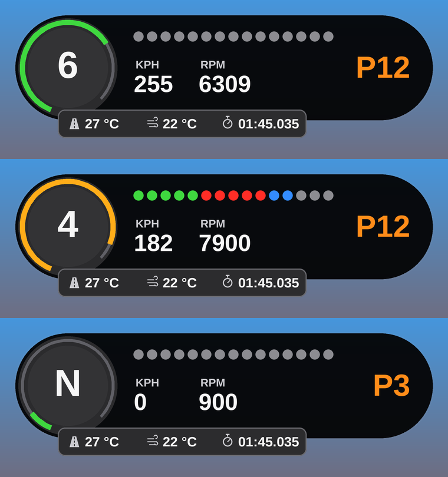

# Dash Bar

Compact driver dash for Assetto Corsa. It's a Custom Shaders Patch Lua app.

## What it shows

- **Gear ring:** the gear sits inside a ring that fills with RPM. The ring is green at low revs, amber once the shift lights start, and red at the shift point.
- **Shift lights:** 15 lights (5 green, 5 red, 5 blue). They all flash blue at the shift point.
- **Speed, RPM and race position**
- **Bottom strip:** track temp, air temp and current lap time. After you cross the line it shows your last lap in purple for a few seconds.

## Install

1. Download the repo as a zip (Code → Download ZIP), or grab the zip from Releases.
2. Drag it onto Content Manager and click Install.
   Or copy `apps/lua/DashBar` into `<Assetto Corsa>/apps/lua/`.
3. In game, turn it on from the app bar on the right.

You need [Custom Shaders Patch](https://acstuff.club/patch/).

## Settings

Open settings from the cog on the app bar. You can change:

- KPH or MPH
- where the shift lights start (default 80% of max RPM)
- the shift point (default 96.5%)
- max RPM override
- how long the last lap time stays on screen

Max RPM is read from the car's rev limiter. If a car doesn't report one, set it in settings.
